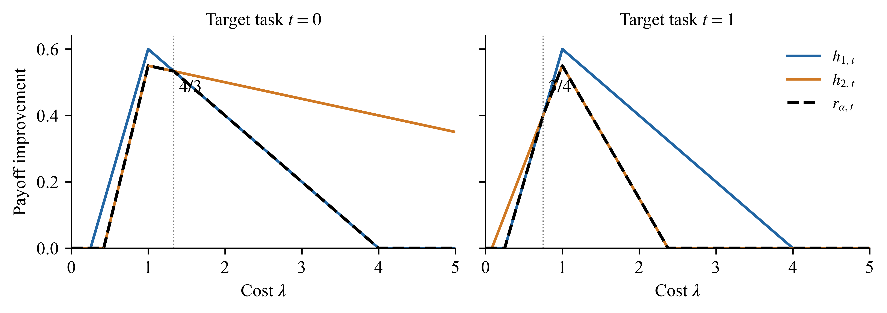
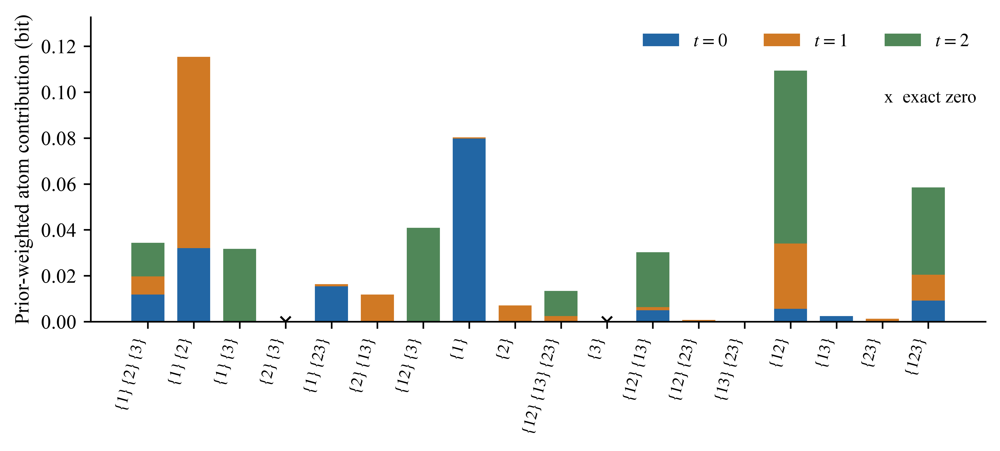
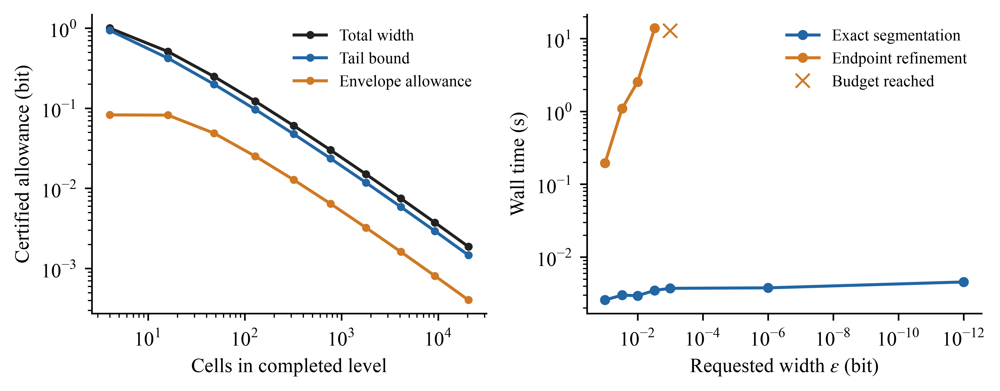

# Multi PID

**Decision-Theoretic Representation and Certified On-Demand Computation of Multisource Partial Information Decomposition**


[](LICENSE)


Compute a requested Shannon MAR redundancy or information atom directly from a finite probability table, with a certified interval for the answer.

This repository implements the paper's decision-payoff representation, exact piecewise integration, and endpoint-based certification. It preserves the existing Mages–Anastasiadi–Rohner (MAR) decomposition and its Williams–Beer lattice. The numerical experiments include independent full-lattice checks, nonuniform targets, dependent sources, and atoms far below binary64 cancellation error.

[Quick start](#quick-start) · [Results](#results) · [Reproduce](#reproduce-the-experiments) · [Method](docs/method.md) · [Reproducibility](docs/reproducibility.md)



*Shared information depends on the task. The lower-envelope source switches at costs 4/3 and 3/4 for the two target categories.*

## What the code provides

- **On-demand queries.** Evaluate one cumulative redundancy or atom using its query antichain and, for atoms, the maximal uncovered boundary.
- **Exact geometry.** Rational probabilities, likelihood-ratio breakpoints, intersections, and branch comparisons.
- **Certified answers.** Rational-logarithm expressions or endpoint enclosures, with explicit interval widths and resource limits.
- **Independent validation.** Geometric cumulative values, full Möbius inversion, and mutual-information reconstruction for every source subset in the supplied examples.

## Quick start

From a local checkout, create an environment with Python 3.10 or newer:

```bash
python -m venv .venv
source .venv/bin/activate
python -m pip install -e ".[experiments,plots,dev]"
```

On Windows, activate with `.venv\Scripts\activate`. To install only the dependency-free query engine, use `python -m pip install -e .`.

### Python

The switching example has eight rational masses. Integer counts are normalized exactly:

```python
from itertools import product

from mar_certified import Distribution, query

counts = [8, 12, 32, 48, 76, 4, 19, 1]
states = product((0, 1), repeat=3)
P = Distribution(dict(zip(states, counts)), kind="counts")

result = query(P, [[1], [2]], kind="atom", method="exact", tol="1e-12")

print(f"{result['approximate']:.12f} bit")
print(result["tolerance_met"])
```

```text
0.219667381288 bit
True
```

States are `(T, X1, ..., Xn)`. The antichain `[[1], [2]]` queries the information shared by the two individual observations; `[[1, 2]]` queries the joint-observation atom. Set `kind="cumulative"` to evaluate cumulative redundancy. Pass rational strings or `fractions.Fraction` for probabilities and tolerances.

The certificate is `result["interval"]`, whose `lower`, `upper`, and `width` are exact fractions. `result["approximate"]` is a convenient floating-point summary. See [the API and mathematical conventions](docs/method.md#inputs-and-query-conventions).

### Command line

```bash
mar-certified query examples/switching.json \
  --alpha '1|2' --kind atom --method exact --tol 1e-12 \
  --output results/local/query.json

mar-certified verify examples/switching.json --tol 1e-12
```

The CLI uses `|` between observation conditions and commas within a condition: `1|2,3` means `{{1}, {2,3}}`. Its JSON output includes exact bounds, structural status, timing, and query metrics. A query that reaches a resource limit before its requested width returns a nonzero exit code; inspect `tolerance_met` before treating an output as complete.

## Results

The committed [reference records](results/reference) retain the measurements used for the manuscript examples. Values below are rounded; the records contain rational interval endpoints.

| Experiment | Result | Validation |
|---|---|---|
| Taskwise envelope switching | Redundancy **0.219667381288 bit**, versus minimum single-source MI **0.278071905113 bit** | All 4 atoms and 3 subset MIs |
| Nonuniform ternary target with dependent sources | **16 positive atoms** among 18 nodes | Exact geometric inversion and all 7 subset MIs |
| Vanishing atom, δ = 10⁻⁹ | **2.88539 × 10⁻¹⁸ bit**; tested binary64 inversion returns a negative value | Positive rational certificate and an independent entropy formula |
| Asymmetric four-source system | **16 positive atoms**, 150 structural zeros | All 166 atoms and 15 subset MIs |



*Each color is a prior-weighted binary-task contribution. Changing conditional source dependence while preserving every singleton channel changes the intermediate atoms.*



*For the tested four-source query, exact segmentation uses 12 positive affine segments. The endpoint method's recorded error is dominated by its tail and envelope allowances.*

At requested width `1e-12`, the recorded exact query takes about **4.55 ms**. Endpoint refinement reaches width **0.001871950391** with **20,480 cells** in its final completed level. Its `1e-3` request reaches the cell budget before meeting the tolerance. These are measurements for this implementation and distribution, with both successful and incomplete runs retained; see [budgets and timing conventions](docs/reproducibility.md#recorded-environment-and-budgets).

## Reproduce the experiments

```bash
# Exact examples, controls, queries, and the full-decomposition baseline
mar-reproduce --suite quick --output results/local

# Also run the small-atom and endpoint precision experiments
mar-reproduce --suite full --output results/local

# Rebuild the displayed figures from the committed measurements
mar-plot --results results/reference --output docs/figures

# Plot your own complete run
mar-plot --results results/local --output results/local/figures
```

The full suite can take several minutes. Endpoint experiments use explicit time and cell budgets, so attained levels and times can vary by machine. The suite retains valid budget-limited outputs as experimental results. New runs go to the ignored `results/local/` directory; the committed reference records stay separate.

Figures are written as vector PDF and 600 dpi PNG. The plotting code uses Times New Roman when available and STIX as a portable fallback, with STIX mathematical glyphs.

## How it works

```text
Rational joint distribution + query antichain
                    |
       Select query and boundary channels
                    |
       Build target-specific payoff curves
                    |
           Construct the query envelope
                 /     \
       Exact segments   Endpoint bounds
              |               |
       Rational logs    Cells + tail bounds
                 \     /
           Certified output interval
```

The query engine is organized around these stages:

| Module | Responsibility |
|---|---|
| `distributions.py`, `channels.py` | Exact inputs, marginalization, and binary target tasks |
| `lattice.py` | Antichain validation, ordering, and maximal uncovered boundaries |
| `piecewise.py`, `exact.py` | Rational affine branches and exact integration |
| `intervals.py`, `endpoint.py` | Logarithm enclosures and endpoint certification |
| `reference.py`, `verification.py` | Independent geometric inversion and reconstruction checks |

See [method details](docs/method.md) for the integrands, logarithm bounds, and interpretation of structural zeros.

## Project layout

```text
src/mar_certified/       Query engine and CLI
src/mar_experiments/     Reproducible experiments and plotting
examples/               Complete input tables
results/reference/      Recorded numerical results
          local/        Your runs (ignored by Git)
docs/figures/           README and manuscript figures
tests/                  Mathematical and interface regression checks
```

## Development

```bash
python -m pip install -e ".[experiments,plots,dev]"
python -m pytest tests
```

[Contributing](CONTRIBUTING.md) describes the checks expected for changes to the arithmetic, geometry, and experiment outputs.

The [release validation record](docs/validation.md) reports the local installation, 17 passing tests, complete experiment run, and figure regeneration. GitHub Actions is configured to test Python 3.10, 3.12, and 3.13 on Linux and Windows.

## Scope and attribution

Certification controls numerical error for the supplied finite rational distribution. Population uncertainty requires additional statistical bounds. Query cost depends on the input support, boundary size, and payoff geometry; the supplied complete-decomposition experiments cover up to four sources.

The underlying decomposition is due to [Mages, Anastasiadi, and Rohner, *Entropy* 26(5), 424 (2024)](https://doi.org/10.3390/e26050424). This repository accompanies the manuscript **Decision-Theoretic Representation and Certified On-Demand Computation of Multisource Partial Information Decomposition** and implements its representation and computation framework.

Licensed under the [MIT License](LICENSE).
